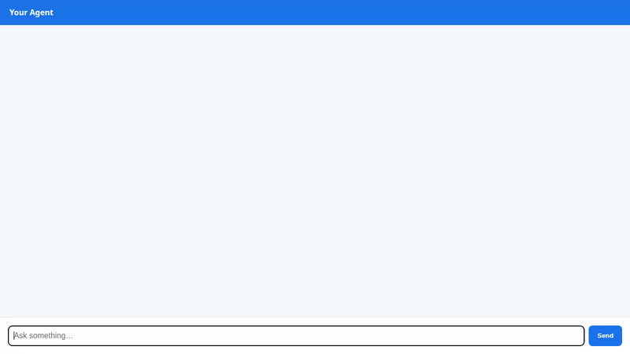

# Travel Concierge ✈️

> A conversational AI travel assistant that helps travelers discover destinations, build personalized itineraries, generate scenic preview visuals & videos, and manage travel preferences with cross-session long-term memory.



---

## 🌟 Key Capabilities & Features

Travel Concierge combines Google Agent Development Kit (ADK), Vertex AI Agent Runtime, and Google Cloud services to deliver an intelligent travel assistant.

### 🧠 Cross-Session Preference Memory
- **Vertex AI Memory Bank**: Persists user preferences, dietary restrictions, health requirements, and allergies across sessions using `VertexAiMemoryBankService` and `PreloadMemoryTool`.

### 🗄️ Destination & Venue Database
- **Google Cloud Firestore**: Provides real-time venue lookups, destination searches, venue details, and custom itinerary persistence (`search_destinations`, `add_destination`, `get_destination_details`).

### 🖼️ Multimodal Visual & Video Generation
- **Google GenAI Image Generation**: Uses `gemini-3.1-flash-lite-image` (in global region) to generate scenic preview images for destinations (`generate_destination_image`).
- **Google GenAI Video Generation**: Uses `gemini-omni-flash-preview` via the Interactions API to generate 10-second cinematic preview videos (`generate_destination_video`).
- **Public Cloud Storage Hosting**: Media files are saved as Playground artifacts and uploaded to a public Google Cloud Storage bucket for direct inline browser rendering.

### 🗺️ Location & Financial Tools
- **Google Maps Platform Integration**: Performs address geocoding (`geocode_address`) and searches nearby places and landmarks (`search_nearby_places`).
- **Financial Calculators**: Real-time currency conversion (`convert_currency`) and trip expense estimations (`calculate_trip_budget`).

### 💻 Sandboxed Code Execution
- **Agent Engine Sandbox Code Executor**: Safely runs Python code inside isolated sandbox environments (`AgentEngineSandboxCodeExecutor`) for complex math and data processing.

### 🎨 Rich Dynamic UI (A2UI v0.8)
- **A2UI Response Schema**: Uses `A2uiSchemaManager` (v0.8) to return structured JSON UI components (Cards, Columns, Rows, Text, and Images) rendered natively in ADK Web and custom frontend chat interfaces.

---

## 🛠️ Architecture & Tech Stack

- **Agent Framework**: Google Agent Development Kit (`google-adk`), Python 3.11+
- **Foundation Models**: `gemini-flash-latest`, `gemini-3.1-flash-lite-image`, `gemini-omni-flash-preview`
- **Google Cloud Platform Services**:
  - Vertex AI Agent Runtime / Agent Engine
  - Vertex AI Memory Bank Service
  - Google Cloud Firestore
  - Google Cloud Storage
  - Google Maps Platform
- **Frontend Architecture**: FastAPI Proxy + HTML5/CSS3 Single-Page Chat UI talking A2A protocol over HTTP.

---

## 🚀 Local Development & Setup Instructions

### Prerequisites
- Python 3.11 or higher
- Google Cloud CLI (`gcloud`) authenticated with target GCP project
- `agents-cli` installed

### 1. Running the Agent Locally
Install dependencies and launch local ADK development server:

```bash
# Install dependencies
pip install -r requirements.txt

# Run the agent in ADK Web UI
adk web app/agent.py
```

Alternatively, run interactively via CLI:

```bash
agents-cli run
```

### 2. Running the Custom Frontend
The frontend consists of a FastAPI proxy server and lightweight chat UI in `./frontend`.

```bash
cd frontend

# Install frontend dependencies
pip install -r requirements.txt

# Set environment variables pointing to your Agent Engine resource and directory
export AGENT_ENGINE_RESOURCE_NAME="projects/<PROJECT_ID>/locations/<LOCATION>/reasoningEngines/<REASONING_ENGINE_ID>"
export AGENT_DIRECTORY="app"

# Start local FastAPI proxy server
python main.py
```

---

## 📋 Planned / Future Enhancements
- [ ] **Live Airline Flight Booking**: Direct API integration for flight availability and seat reservations (planned).
- [ ] **Real-Time Hotel Reservation Engine**: Live hotel room booking and confirmation flow (planned).
